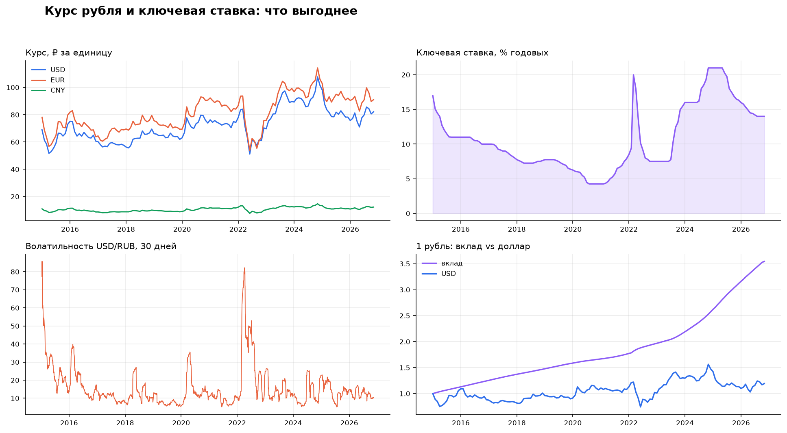
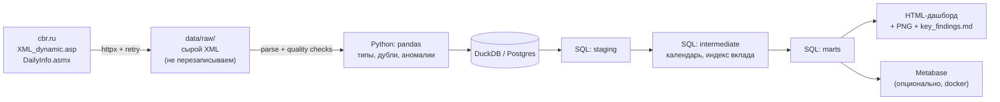

# Курс рубля и ключевая ставка: что выгоднее

*ETL-пайплайн и аналитические витрины по официальным данным Банка России: сравнение рублёвого вклада
под ключевую ставку с покупкой валюты на горизонтах от месяца до трёх лет. Python · SQL · DuckDB · GitHub Actions.*

[](pyproject.toml)
[](LICENSE)
[](https://www.cbr.ru/scripts/XML_dynamic.asp)
[](tests)


[](https://github.com/USER/cbr-analytics/actions/workflows/ci.yml)




> **English summary.** An end-to-end analytics project on Bank of Russia open data: incremental
> XML/SOAP extract → DuckDB warehouse → SQL marts → single-file HTML dashboard. Answers a concrete
> question: over 2015–2026, would a ruble deposit at the CBR key rate have beaten holding USD/EUR/CNY?

---

## 1. Вопрос, на который отвечает проект

Дан рубль и горизонт *H*. Что даст больше в рублях: положить его на вклад по ключевой ставке
или купить валюту и просто держать?

Ответ в проекте считается не «на глаз», а по всем доступным датам старта с 2015 года — то есть
проверяется не один удачный период, а *распределение исходов*.

## 2. Ключевые выводы (данные на 14.11.2026)

| Горизонт | Доля случаев, когда вклад выиграл (USD) | Медианный перевес | Разброс (p10…p90) |
|---|---|---|---|
| 1 месяц | **59%** | +0,9 п.п. | −5,8 … +6,1 п.п. |
| 3 месяца | **63%** | +2,5 п.п. | −11,3 … +12,1 п.п. |
| 6 месяцев | **65%** | +4,7 п.п. | −16,4 … +18,0 п.п. |
| 1 год | **67%** | +9,8 п.п. | −14,6 … +31,6 п.п. |
| 3 года | **85%** | +17,9 п.п. | −3,7 … +52,2 п.п. |

1. **Горизонт решает всё.** На месяце преимущество вклада — статистический шум (59% против 41%,
   разброс шире самого эффекта). На трёх годах вклад выигрывал в 85–87% случаев по всем трём валютам.
2. **1 рубль, вложенный в январе 2015:** вклад под ключевую ставку → **3,54 ₽**, доллар → **1,19 ₽**,
   евро → 1,17 ₽, юань → 1,12 ₽.
3. **Волатильность — цена валютной ставки.** σ доллара доходила до 86% годовых (январь 2015) и до ~82%
   в феврале 2022; в спокойные годы — 5–10%. Вклад в модели не колеблется вообще.
4. **Текущий коридор (не прогноз).** При волатильности на 14.11.2026 95%-й коридор доллара на 30 дней —
   77,45–87,14 ₽ при курсе 82,15 ₽.

Полный список выводов генерируется автоматически в [`docs/key_findings.md`](docs/key_findings.md),
интерактивная версия — [`docs/dashboard.html`](docs/dashboard.html) (один файл, открывается без интернета).

## 3. Архитектура



Слои как в классическом хранилище:

| Слой | Файл | Что делает |
|---|---|---|
| raw / bronze | `data/raw/**` | сырые ответы ЦБ, байт в байт, партиции по валюте и году |
| staging | `sql/01_staging.sql` | типы и имена, никакой логики |
| intermediate | `sql/02_intermediate.sql` | календарь, forward fill, индекс вклада, доходности, волатильность |
| marts | `sql/03_marts.sql` | 6 витрин, каждая отвечает на один вопрос |
| report | `src/cbr_analytics/report/` | самодостаточный HTML + PNG |

## 4. Источники данных

| Что | Источник | Формат | Ключ |
|---|---|---|---|
| Курсы USD/EUR/CNY, история с 1999 | [`cbr.ru/scripts/XML_dynamic.asp`](https://www.cbr.ru/scripts/XML_dynamic.asp) | XML (windows-1251) | не нужен |
| Ключевая ставка | [`cbr.ru/DailyInfoWebServ/DailyInfo.asmx`](https://www.cbr.ru/DailyInfoWebServ/DailyInfo.asmx) → `KeyRateXML` | SOAP/XML | не нужен |

Обе ручки официальные и бесплатные, регистрация не требуется. Две грабли, на которые уже наступлено
(и закрыты тестами):

* XML приходит в **windows-1251** с десятичной запятой — парсим байты, а не `response.text`;
* у части валют `Nominal ≠ 1` (например, у JPY — 100), поэтому курс всегда нормируется на единицу;
* в SOAP-сервисе имена полей **несимметричны**: `fromDate` и `ToDate`; при ошибке сервис возвращает
  `200 OK` с пустым `<KeyRate><Error /></KeyRate>` — валидатор обязан это ловить.

## 5. Быстрый старт

```bash
git clone https://github.com/USER/cbr-analytics.git && cd cbr-analytics
python -m venv .venv && source .venv/bin/activate   # Windows: .venv\Scripts\activate
make install          # pip install -e ".[dev]"
make all              # extract -> витрины -> проверки -> дашборд
open docs/dashboard.html
```

Три команды — и дашборд есть. Дальше:

```bash
make extract     # только скачать данные (кэшируется в data/raw, повторно не качает)
make build       # пересобрать витрины из скачанного (секунды, без сети)
make report      # пересобрать дашборд
make test        # 26 тестов, сеть не нужна
make up          # Postgres + Metabase, если нужен настоящий BI
```

Вариант с настоящим BI (Metabase на Postgres):

```bash
cp .env.example .env
make up
CBR_ENGINE=postgres python -m cbr_analytics all
# http://localhost:3000 -> New database -> PostgreSQL, host=db, db=cbr, user=cbr, pass=cbr
```

## 6. Модель витрин

| Витрина | Вопрос, на который отвечает |
|---|---|
| `mart_fx_monthly` | что происходило с курсом и ставкой по месяцам |
| `mart_volatility` | когда рубль «трясло» и насколько |
| `mart_deposit_vs_fx` | по каждой дате старта и горизонту: доходность вклада, доходность валюты, разница |
| `mart_headline` | сводка по горизонтам: доля побед, медиана, p10/p90 |
| `mart_monthly_index` | накопленный результат 1 рубля: вклад vs каждая валюта |
| `mart_forecast_band` | 95%-й коридор курса на 30 дней при текущей волатильности |

Пример запроса к витрине — сколько раз и насколько вклад обогнал доллар за год:

```sql
SELECT char_code,
       COUNT(*)                AS n_periods,
       AVG(deposit_won)        AS win_share,
       MEDIAN(diff_pp)         AS median_pp   -- в DuckDB; в Postgres percentile_cont(0.5)
FROM mart_deposit_vs_fx
WHERE horizon_days = 365
GROUP BY 1;
```

## 7. Методика и допущения

* **Рублёвый вклад** — ежедневное начисление `ключевая_ставка / 100 / 365`, без налога, без капитализации
  ограничений банка, без спреда. Это верхняя оценка доходности вклада (идеальный «безрисковый» рубль).
* **Валюта** — куплена по официальному курсу ЦБ в день старта, продана по курсу через *H* дней,
  без комиссий и спреда обменника (тоже верхняя оценка).
* **Горизонты — календарные дни.** Курс на выходные протягивается последним известным значением,
  иначе горизонт 365 дней не совпал бы с 365-дневным депозитом.
* **Волатильность** считается только по дням публикации курса и аннуализируется через √252;
  если считать по календарю с нулевыми выходными, σ занижается примерно на 13%.
* **Ключевая ставка** применяется к тем же дням, что и начисление процентов (ставка на календарный день).

## 8. Ограничения — что проект честно не умеет

* Нет инфляции и налога на валютную переоценку / доход по вкладу — сравнение «до налогов».
* Нет спреда банка и комиссий обменника: в реальности валютная стратегия проигрывает чуть быстрее.
* Нет альтернатив (фонды, облигации, недвижимость) — только «вклад vs одна валюта».
* `mart_forecast_band` — **не прогноз**. Это коридор из исторической σ при допущении случайного
  блуждания; он ничего не знает про ставку, инфляцию и решения ЦБ.
* Доля побед вклада зависит от периода: 2015 и 2022–2026 — годы высокой ставки. Это режим, а не закон рынка.
* Нет событийных данных (санкции, обвалы) — только следствия, видимые в курсе.

## 9. Качество и тесты

```bash
$ make test
26 passed
```

* **Тесты парсеров** — на сохранённых ответах ЦБ (`tests/fixtures`), без сети: windows-1251,
  запятая как разделитель, `Nominal ≠ 1`, пустой SOAP-ответ.
* **Тесты очистки** — отсечение дат вне периода, дублей, неположительных курсов.
* **Проверки качества данных** — 6 проверок до загрузки (объём, пропуски, знак, дубли, скачки > 3×)
  и 6 на витринах (нет `NULL`-доходностей, доля побед в [0,1], коридор упорядочен). Не прошло — пайплайн
  останавливается, а не пишет мусор в витрины.
* **Интеграционный тест SQL** — весь пайплайн на DuckDB с детерминированными данными: проверяется, что
  индекс вклада равен `exp(rate) − 1`, что курсы на выходные протянуты, что плоская валюта при ставке 10%
  всегда проигрывает вкладу.
* **CI** (GitHub Actions) — `ruff` + `pytest` на каждый push; еженедельный workflow обновляет данные
  и коммитит свежий дашборд, так что в репозитории всегда актуальная версия отчёта.

## 10. Структура репозитория

```
cbr-analytics/
├── config/config.yaml          # период, валюты, горизонты — всё вынесено из кода
├── src/cbr_analytics/
│   ├── extract/                # currency.py, key_rate.py — HTTP + парсинг XML
│   ├── transform/              # clean.py (типы), quality.py (проверки)
│   ├── load/warehouse.py       # DuckDB / Postgres, рендер SQL-шаблонов
│   ├── report/                 # charts.py (свой SVG), dashboard.py (HTML + PNG)
│   ├── pipeline.py             # оркестрация
│   └── cli.py                  # python -m cbr_analytics {extract,build,report,all}
├── sql/                        # 01_staging -> 02_intermediate -> 03_marts
├── tests/                      # 26 тестов + фикстуры ответов ЦБ
├── docs/                       # dashboard.html, dashboard.png, key_findings.md, decisions.md
├── docker-compose.yml          # Postgres + Metabase (опционально)
└── Makefile
```

## 11. Что дальше

* [ ] Инфляция (Росстат / `индекс потребительских цен`) → реальная, а не номинальная доходность.
* [ ] Налоги: НДФЛ 13% на доход по вкладу, налог на валютную переоценку.
* [ ] Спред и комиссии: реалистичный P&L валютной стратегии.
* [ ] Портфель 50/50 вместо «всё в одну валюту» — как меняется разброс исходов.
* [ ] dbt вместо ручного SQL — когда витрин станет больше десяти.
* [ ] Airflow/Prefect вместо cron в GitHub Actions.

---

Данные — Банк России, открытая лицензия на использование. Код — MIT.
Проект учебный: это не инвестиционная рекомендация.
